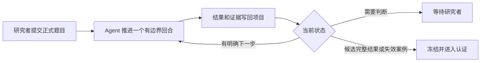

# Cardiac Surrogate Research Workspace

让心脏代理模型研究跨会话继续，并保留可审查的证据链。

[](https://github.com/hollylewis977-ui/cardiac-workspace/actions/workflows/ci.yml)
[](LICENSE)

这个工作台面向使用 Codex 或 Claude 进行代理模型实验、失效案例构造、文献核查和计算实验的研究者。
它把正式题目、方法族、命题依赖、证据等级、失败记录和下一步保存在项目目录中。研究可以跨越很多会话继续，
不必依赖一段不断增长的聊天记录。它位于 **PDE 心脏代码2** 项目内部，实际源码、数据和权重都在上一级目录。

[快速开始](#快速开始) · [先看题目](#先看题目) · [核心能力](#核心能力) ·
[执行边界](#执行边界) · [证据与安全边界](#证据与安全边界)

## 适合谁

这个工作台适合需要长期推进一个代理模型问题，并且希望保留完整研究轨迹的个人研究者或小型团队。
它特别适合以下任务：

- 一个主命题需要多个方法族和多轮失效案例测试；
- 研究过程会跨会话、跨模型或跨 Agent；
- 训练结果必须和独立复核、文献事实、人工确认严格区分；
- 多个研究任务需要在后台公平轮转，或需要专注运行其中一个。

它不是预测有效性的自动保证，也不是新的模型。工作台负责组织 Agent 的研究过程，
研究者仍然负责确认题目、检查证据并决定是否公开结论。

## 快速开始

### 1. 读正式题目

```text
projects/cardiac-ep/problem.md
```

主命题是时间外推算子：只看 0–500 ms 的 V/Ca 观测，预测 502–1000 ms 的场与激活事件。定义、归一化、
已知结果和已试路线都在这一份文件里。

### 2. 检查环境

```powershell
python tools/cardiac_workspace.py doctor
python tools/cardiac_workspace.py list
```

`doctor` 只读检查源码入口、依赖和 NPZ 头信息，不加载完整轨迹。所有项目代码的实际执行必须在 254 服务器的
Slurm 分配内进行，见[执行边界](#执行边界)。

### 3. 加入一道题

```powershell
python tools/research_queue.py add my-task "任务标题"
```

填写：

```text
problems/cardiac-research/items/my-task/task.json
```

目标、范围与验收项由研究者维护；再把 `ready` 改为 `true`。Runner 会保存输入快照，研究 Agent 不会改写原题。
第二道题 `personalization` 已登记但未就绪，等有影响动力学的数据后再启动。

### 4. 先跑一个回合

```powershell
python tools/research_queue.py check
python tools/research_queue.py packet neural-ode-full500
python tools/research_queue.py once --slug neural-ode-full500 --dry-run
```

`check` 只检查环境和任务；`packet` 只读预览研究包；`--dry-run` 显示命令但不调用模型。

### 5. 需要时连续推进

```powershell
python tools/research_queue.py run --slug neural-ode-full500 --max-rounds 5 --max-hours 2
python tools/research_queue.py status
python tools/research_queue.py stop
```

`run` 在前台连续调用 Codex；`stop` 在当前回合保存后退出，再次 `run` 从已有状态接续。自动循环至今未真实运行，
所有记录由交互式会话维护。

## 先看题目

`projects/cardiac-ep/` 是一道题的完整骨架，文件互相引用：

```text
problem.md
    ↓
CURRENT_STATE.md
    ↓
ideas.md + research-tree.md + claim-map.md
    ↓
verification-ledger.md + progress.md
    ↓
references.md + SOURCE_MAP.md
```

候选结果即使看起来完整，也停在 `proof-draft`。工作台不会自动把它升级为独立复核或人工确认的结果。

## 它解决什么

| 常见问题 | 工作台的处理方式 |
|---|---|
| 新会话不了解上次做到哪里 | `CURRENT_STATE.md` 保存题目范围、最小缺口和证据指针 |
| Agent 重复失败路线 | `ideas.md` 和 `research-tree.md` 记录方法族、失败类型与重开条件 |
| 未验证的结果逐渐变成默认前提 | `claim-map.md` 和 `verification-ledger.md` 保存依赖与证据等级 |
| smoke 或低 loss 被写成结论 | 计算证据最高先标为 `experimental` |
| 一个任务占用全部时间 | 队列按上次运行时间公平轮转，也支持单任务运行 |
| 模型声称达标后继续自动运行 | 候选完整结果触发认证，等待研究者复核 |

## 工作方式



每个回合只负责一个有边界的贡献：分析一个失效、修改代码、运行授权实验或评估结果。长期运行来自连续回合和
磁盘状态。每轮至少保存一项可复核产物，例如已验证修复、可复现基线、消融比较、定位到代码或数据的失败、
认证过的失效案例或明确实验方案。

普通回合由一个研究 Agent 沿当前缺口继续推进。只有研究者明确要求多智能体时，才增加独立审查 Agent。
认证只冻结受影响的依赖节点；主命题的候选完整结果触发全题认证，等待人工复核。

## 核心能力

| 能力 | 对应组件 |
|---|---|
| 可恢复研究回合 | `CURRENT_STATE.md`, `progress.md` |
| 方法族和失败路线管理 | `ideas.md`, `research-tree.md` |
| 命题依赖追踪 | `claim-map.md` |
| 证据分级 | `verification-ledger.md`, `agents/core/research-core.md` |
| 认证与失效案例 | `agents/protocols/claim-audit.md`, `failure-case-audit.md` |
| 独立复核 | `agents/protocols/independent-replication.md` |
| 进展判定 | `agents/protocols/progress-assessment.md` |
| 多任务轮转与单任务长跑 | `tools/research_queue.py` |
| 回合内实验执行 | `tools/cardiac_workspace.py`, `cardiac-workspace.json` |
| 文献与架构对照 | `references.md`, `agents/protocols/literature-check.md` |
| 发布前完整性检查 | GitHub Actions, `tools/update_manifest.py` |

`AGENTS.md` 保存所有任务共用的研究纪律。`agents/protocols/` 按阶段拆分详细规则，`library/definitions/` 放
定义，`templates/` 放题目、方法族、研究树、命题依赖图、审查报告和短状态的模板。

## 执行边界

2026-09-29 起，所有项目代码执行，包括研究队列、训练、评估、绘图、数据处理、CPU/GPU 测试和 smoke，必须通过
254 服务器 Slurm 排队取得资源后进行；本机和登录节点只做文件操作、SSH、传输、提交与查询。本页命令只列接口。

`cardiac-workspace.json` 的 `project_root` 指向上一级心脏项目（默认 `..`）；上级 AGENTS.md 是薄入口，要求读取
本工作台。迁到服务器时用配置副本的 `project_root`、`data_dir` 和运行目录指定实际路径，再用
`--config /path/to/config.json`。根目录 `global-memory-queue.json` 与 `global-memory-workspace.json` 是服务器
`code/NeuralODE_GlobalMemory/slurm/agent.sbatch` 引用的队列配置副本。

心脏项目两套目录各自测试，各用一个 Python 进程：

```powershell
python -B -m unittest discover -s code/TC_GCN_server -p "test_*.py" -v
python -B -m unittest discover -s code/FBNO_time_forecast -p "test_*.py" -v
```

## 证据与安全边界

### 证据等级

| 等级 | 含义 |
|---|---|
| `conjecture` | 只有假设，没有任何运行 |
| `experimental` | 单种子、短预算或合成数据上的数值信号 |
| `partial-result` | 只在受限范围成立：必要条件、训练段、单病例、固定权重下限 |
| `proof-draft` | 完整协议下成立，但只有本会话自报 |
| `agent-verified` | 独立作业从冻结权重和源码哈希重算一致，十项审查通过 |
| `human-verified` | 研究者逐项看过证据并明确接受 |
| `formalized` | 在开发中从未接触的数据上成立 |

smoke 只证明可执行，低 loss 不是结论，单病例图不是验证。Agent 给出的完整结果最高先标为 `proof-draft`。
只有研究者能够把它升级为 `human-verified`。

### 公开仓库不包含研究数据

这个仓库只发布框架、协议、模板、工具、测试和当前题目的状态文件。`runs/` 和 `projects/cardiac-ep/queue/`
不提交；权重、数据集、PDF 和登录配置不会进入仓库。

提交前运行：

```powershell
python tools/update_manifest.py write
python -m unittest discover -s tools/tests -v
```

清单不包含 `runs/`、`projects/cardiac-ep/queue/` 和 `projects/cardiac-ep/*.md`。GitHub Actions 会在每次 push 和
pull request 上重复清单检查与测试。

## 关于独立复核

普通回合只需要一个研究 Agent。独立复核是可选的升级通道，用于同一缺口两轮未闭合，或 `proof-draft` 申请升
`agent-verified` 的情形。Agent 只准备交接稿（命题、协议、冻结权重与源码哈希、命令、容差、验收），提交走研究者已
授权的 Slurm 预算；复核作业与训练作业分离，复核脚本不改模型或协议。流程见
`agents/protocols/independent-replication.md`。

## 研究范围

当前主命题是参考域上二维 CRN 合成数据的时间外推算子，方法族包括 AR 一步算子、固定 PCA 低维推进、图 Neural ODE、
直接时间查询和区域记忆态 H。几何个体化、参数反演和真实患者验证属于第二道题，当前数据不支持。

目录、队列和证据规则不依赖这些具体方向。修改 `problem.md`、`AGENTS.md` 和模板后，也可以用于其他需要长期
实验推进的代理模型问题。

## 文档

- [研究规则](AGENTS.md)：证据、审计与权限边界
- [队列说明](problems/cardiac-research/README.md)：任务配置、运行与恢复
- [设计文档](docs/superpowers/specs/2026-10-13-cardiac-math-framework-design.md)：2026-10-13 数学框架重建
- [改造记录](docs/ADAPTATION_REPORT.md)：2026-09-16 从图几何工作台改造为心脏工作台
- `archive/math-framework/`：原版数学框架文件，供对照；完整原版快照在 `../../agent-adaptation-backup-20260916-131832/original-agent.zip`

## License

MIT License。可以复制、修改和再发布，但需要保留版权及许可声明。
