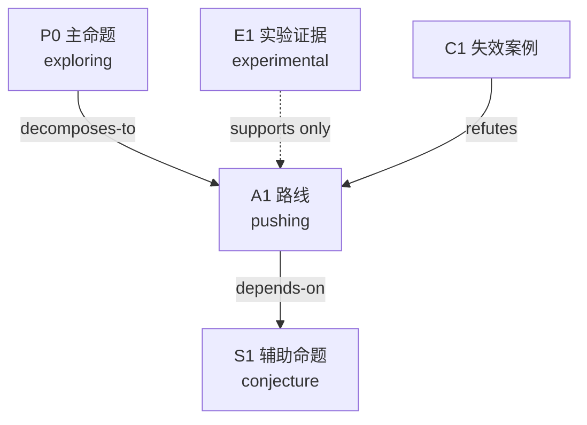
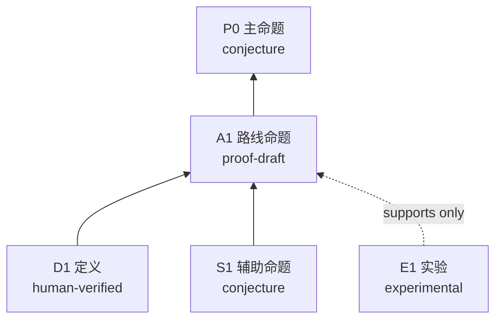
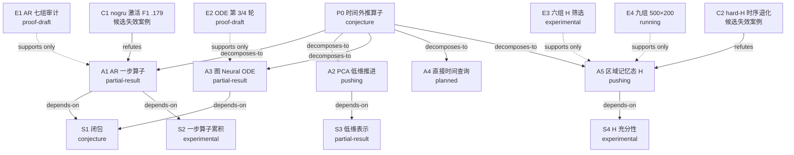
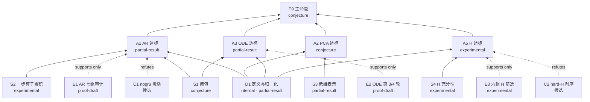

# 心脏代理模型数学框架 实施计划

> **For agentic workers:** REQUIRED SUB-SKILL: Use superpowers:subagent-driven-development (recommended) or superpowers:executing-plans to implement this plan task-by-task. Steps use checkbox (`- [ ]`) syntax for tracking.

**Goal:** 把 cardiac-workspace 重建为原版"一道题"的数学框架，主命题是时间外推算子，记录只有一套。

**Architecture:** projects/cardiac-ep/ 承载题目、短状态、方法族、研究树、命题依赖图、台账、文献槽；agents/ 分数学框架层与计算实验层；library/ 放定义、结论、失效案例、例子；tools 只改研究包清单和结果校验。

**Tech Stack:** Markdown、JSON Schema、Python 3 标准库（unittest），Git。所有命令在 `cardiac-workspace/` 下用 Git Bash 执行。设计文档：`docs/superpowers/specs/2026-10-13-cardiac-math-framework-design.md`。

**通用规则：**
- 每个任务最后一步提交前先 `python tools/update_manifest.py write`，再 `git add`，保证每个提交的 manifest 一致。
- 不改心脏项目源码、权重、数据；不运行训练；不启动队列。
- 文件一律 UTF-8、LF。`.gitattributes` 已设 `* -text`。
- 文中"等级"指七级：conjecture / experimental / partial-result / proof-draft / agent-verified / human-verified / formalized。

---

## 文件总图

新建：
- `projects/cardiac-ep/problem.md`、`ideas.md`、`research-tree.md`、`claim-map.md`、`references.md`
- `problems/cardiac-research/items/personalization/problem.md`、`task.json`
- `library/definitions/{flow-map,observation-operator,closure,scaler-nrmse,activation-event,time-windows}.md`、`library/results/README.md`、`library/failure-cases/README.md`、`library/examples/README.md`
- `templates/{problem,ideas,research-tree,claim-map,claim-audit-report,CURRENT_STATE}.md`
- `agents/protocols/{claim-audit,failure-case-audit,independent-replication,progress-assessment}.md`
- `tools/tests/test_round_result_claims.py`
- `docs/ADAPTATION_REPORT.md`（移动）

重写：`projects/cardiac-ep/CURRENT_STATE.md`、`SOURCE_MAP.md`；`agents/core/research-core.md`；`agents/protocols/explore.md`、`literature-check.md`；`agents/instructions/research-workflow.md`；`AGENTS.md`；`README.md`。

修改：`projects/cardiac-ep/verification-ledger.md`（加列）、`progress.md`（3 处链接 + 追加 1 节）；`agents/core/queue-core.md`（1 行）；`agents/protocols/round-result.md`（追加 1 节）；`templates/cardiac-round-result.schema.json`；`tools/research_runtime.py`；`tools/tests/test_research_queue.py`（fixture 2 行）；`cardiac-workspace.json`；`problems/cardiac-research/README.md`（1 行）；`.github/workflows/ci.yml`；上级 `../AGENTS.md`（1 行）。

删除：`projects/cardiac-ep/experiments.md`、`evidence-map.md`；`templates/project_template/`；`library/*/.gitkeep`；`index/`、`environments/`、`examples/`、`shared/`；`queue.sh`、`queue.ps1`、`setup.sh`、`PDE_BRIDGE.md`、`SETUP_AI_PROMPT.md`。

---

### Task 1: 正式题目与第二道题

**Files:**
- Create: `projects/cardiac-ep/problem.md`
- Create: `problems/cardiac-research/items/personalization/problem.md`
- Create: `problems/cardiac-research/items/personalization/task.json`

- [ ] **Step 1: 写 projects/cardiac-ep/problem.md**

```markdown
# 时间外推算子：正式题目

搜索承诺：either（既找有效算子，也找严格失效案例）。来源标签：internal / provided-source / web-source。

## 定义与归一化

- 参考域 Ω：二维网格，N = 43,573 节点；参考图 L 为邻居差分算子（生成器 ref_nm）。
- 状态 y(t) ∈ R^{N×21}，演化 y'(t) = D·L y(t) + R(y(t))，D = 0.08，R 为 Courtemanche 1998 反应项。生成器每步先做扩散并裁剪 V，再离子步进。
- 时间：内部步长 0.02 ms，保存步长 2 ms，共 1001 帧（0–2000 ms）。
- 观测算子 O(y) = (V, Ca) = (y₀, y₁₈)。记 u_k = O(y(2k ms))。
- 流映射 Φ_τ: y(t) ↦ y(t+τ)。代理模型 G 只能作用在观测序列上，不能作用在 y 上。
- 数据：750 例，初值由单细胞模板初相位生成；x_mesh 形变坐标不进入演化。按完整文件切分 train=batch_000..019、val=020..021、test=022..024，即 600/60/90 例。
- 归一化：Scaler 固定 V ∈ [−100, 50] mV、Ca ∈ [0, 0.0012] mM；NRMSE 分母 150 mV / 0.0012 mM。
- 激活事件：V 上穿 −20 mV；首次激活漏检、误检、匹配时间 MAE 按 code/TC_GCN_server 的事件评价实现；无匹配事件时 MAE=0 不算准确。
- 四个时间范围必须分别声明：训练监督截止、验证选模窗口、测试观测截止、评分窗口。

定义的逐条说明见 library/definitions/。

## 主命题 P0

存在算子 G，仅以 u₀…u₂₅₀（0–500 ms 观测）为输入，使未见初值的病例在 k = 251…500（502–1000 ms）上，V 与 Ca 的 NRMSE 以及首次激活事件指标（漏检率、误检率、时间 MAE）同时达到验收阈值。

验收阈值由研究者填写。在填写前，候选算子必须至少优于旧 AR 基线：晚期 RMSE 66.80 mV / 405.65 nM，首次激活漏检 46.86%，下降事件 F1 0.180（AR-BASE-002）。

## 辅助命题

| ID | 命题 | 当前等级 | 可证伪测试 |
|---|---|---|---|
| S1 闭包 | 0–500 ms 的 V/Ca 历史决定 y(500 ms) 的全部 21 维 | conjecture | 用生成器构造同一观测历史、不同隐态的两例，比较 502–1000 ms 的 V/Ca 是否分叉 |
| S2 一步算子累积 | 2 ms 一步算子 G₁ 推 250 步后误差可控 | experimental（AR 七组晚期误差） | 固定权重下误差随预测跨度的曲线；persistence 对照 |
| S3 低维表示 | PCA256 的重建误差低于验收阈值 | partial-result（pca_oracle） | 90 例重建误差分布 |
| S4 记忆态 H 充分性 | 区域记忆态 H 补足 S1 缺的信息 | experimental（六组 80 更新筛选） | 有 H 与无 H 在同协议下的激活 F1 与时间 MAE |

## 允许使用的基础事实

- 生成器源码事实（上节）。
- verification-ledger.md 中等级为 agent-verified 及以上的条目。目前没有；AR-BASE-001 是第一个审查对象。

## 已知结果

| 结果 | 等级 | 证据 |
|---|---|---|
| AR 七组消融 | proof-draft | results/ar/audit_20261008/summary.json；AR-BASE-002 |
| Neural ODE 第 3 轮 90 例全窗 25.77 mV / 170.8 nM 对 AR 53.65 / 293.2 | proof-draft | NODE-GRAPH-003 |
| 六组 H 筛选，hard-H V 17.57 mV / Ca 134.71 nM / Dice .567 | experimental | NODE-GLOBAL-SCREEN-001 |
| 九组 500×200 正式训练 | 进行中 | results/neural_ode_full500/session_20261009_recovery/ |

## 已试路线与失败位置

- F1 AR：晚期 RMSE 66.80 mV，首次激活漏检 46.86%；nogru 场误差最低但激活 F1 仅 .179，失败类型 failure-case。
- F3 图 Neural ODE：第 4 轮双场改善但激活 F1 .567 低于 AR .571，早期 Ca 差；与 AR 的监督/选模协议不同，失败类型 definition-mismatch。
- F5 区域记忆态 H：hard 约束激活时间 MAE 25.2 → 35.5 ms、误激活 .65% → 4.41%，失败类型 failure-case（候选，未认证）。

方法族登记见 ideas.md，路线状态见 research-tree.md，命题依赖见 claim-map.md。

## 不属于本题

几何个体化、参数反演、真实患者验证属于第二道题 problems/cardiac-research/items/personalization/problem.md；当前数据的几何形变不进入动力学，不能从本题结果推出。
```

- [ ] **Step 2: 写第二道题**

`problems/cardiac-research/items/personalization/problem.md`：

```markdown
# 个体化可识别性：正式题目（未启动）

## 问题陈述

给定影响动力学的个体参数 θ（几何、扩散系数 D、离子参数、刺激位置之一或组合）和观测算子 O，是否存在从观测序列到 θ 的可识别映射，并且在校准数据与验证数据严格分离时，个体化后的代理模型预测优于非个体化模型。

## 当前状态

conjecture。当前 v10 数据的 x_mesh 形变不进入演化，D 固定 0.08，没有任何参数变化的数据集；本题没有可运行实验。

## 启动条件

1. 定义可识别参数集合与观测算子。
2. 生成或获得参数变化确实影响动力学的数据集。
3. 写出校准 / 验证分离协议。

满足三条后把 task.json 的 ready 与 enabled 改为 true。
```

`problems/cardiac-research/items/personalization/task.json`：

```json
{
  "slug": "personalization",
  "title": "个体化可识别性（未启动）",
  "objective": "在有影响动力学的参数变化数据后，定义可识别参数、观测算子与校准/验证分离协议，再评估个体化代理模型。",
  "scope": "当前没有数据支撑，不运行任何实验；题目见同目录 problem.md。",
  "ready": false,
  "enabled": false,
  "priority": 0,
  "max_rounds": 0,
  "acceptance": [
    {"id": "C1", "description": "可识别参数集合与观测算子已写入 problem.md 并经研究者确认。"},
    {"id": "C2", "description": "存在参数变化影响动力学的数据集，含生成器版本、参数范围与样本数。"},
    {"id": "C3", "description": "校准与验证数据严格分离的协议已写明并被实验脚本执行。"}
  ]
}
```

- [ ] **Step 3: 检查队列仍能列出任务**

Run: `python tools/research_queue.py list`
Expected: 列表含 personalization，状态显示未就绪/未启用，退出码 0。

- [ ] **Step 4: 提交**

```bash
python tools/update_manifest.py write
git add projects/cardiac-ep/problem.md problems/cardiac-research/items/personalization MANIFEST.sha256
git commit -m "Add formal problem statement and personalization placeholder task"
```

---

### Task 2: library 填实

**Files:**
- Create: `library/definitions/flow-map.md`、`observation-operator.md`、`closure.md`、`scaler-nrmse.md`、`activation-event.md`、`time-windows.md`
- Create: `library/results/README.md`、`library/failure-cases/README.md`、`library/examples/README.md`
- Delete: `library/definitions/.gitkeep`、`library/theorems/.gitkeep`、`library/counterexamples/.gitkeep`、`library/examples/.gitkeep`（theorems/ 与 counterexamples/ 目录整体删除）

- [ ] **Step 1: 六条定义**

`library/definitions/flow-map.md`
```markdown
# 流映射 Φ_τ

Φ_τ: y(t) ↦ y(t+τ)，y ∈ R^{N×21}，由 y' = D·L y + R(y) 的数值积分定义：每步 0.02 ms，先扩散并裁剪 V，再离子步进。
实现：code/DATASET/total_generator_normalize_v10.py 的 simulate_200ms_and_sample（名称过时，实际 total_ms=2000）。
代理模型逼近的不是 Φ_τ 本身，而是观测序列上的复合 O∘Φ_τ 在历史条件下的推进。
```

`library/definitions/observation-operator.md`
```markdown
# 观测算子 O

O(y) = (V, Ca) = (y₀, y₁₈)。full_init 保存 21 维完整初态，之后只保存 V/Ca。
单帧 V/Ca 不是闭合状态；GRU 隐状态或区域记忆态 H 是模型内部表示，不是测得的离子状态。
NPZ 成员 u/ca 形状 [30, 1001, 43573]，float16；x_uni/x_mesh 为 [30, 43573, 2]。
```

`library/definitions/closure.md`
```markdown
# 闭包

命题 S1：0–500 ms 的 V/Ca 历史决定 y(500 ms) 的全部 21 维。
若 S1 不成立，任何只看观测的算子 G 的未来预测在不同隐态间必然分叉，误差下界非零。
可证伪测试：用生成器构造观测历史相同、门控/离子浓度不同的两例，比较 502–1000 ms。
当前等级 conjecture。
```

`library/definitions/scaler-nrmse.md`
```markdown
# Scaler 与 NRMSE

Scaler 固定范围 V ∈ [−100, 50] mV，Ca ∈ [0, 0.0012] mM。
NRMSE 分母固定：V 150 mV，Ca 0.0012 mM。归一化误差与物理误差分开报告。
全域 NRMSE 与活动区 NRMSE 都要给；persistence（保持 500 ms 帧不变）是必报对照。
实现：code/TC_GCN_server/data.py 的 Scaler；指标见 quantify_results.py。
```

`library/definitions/activation-event.md`
```markdown
# 激活事件

阈值 −20 mV 上穿记为激活。指标：首次激活节点漏检率、误检率、匹配事件数、匹配时间 MAE；下降事件 F1 另算。
无匹配事件时 MAE=0 不表示准确；首次上穿不替代再次激活与复极检查。
实现：code/TC_GCN_server/quantify_results.py。
```

`library/definitions/time-windows.md`
```markdown
# 四个时间范围

1. 训练监督截止：优化器看到的标签时间（AR 默认 500 ms；--supervision-end-ms 1000 扩大；ODE 组可至 1000 ms）。
2. 验证选模窗口：选 best 的时间段（AR 默认 500–1000 ms；--strict-validation 用 100/250/400 ms 锚点）。
3. 测试观测截止：部署预测只读 0–500 ms（251 帧）。
4. 评分窗口：502–1000 ms（250 帧）。
比较两个模型时四项都要写明；只写"训练未过 500 ms"不等于"选模未过 500 ms"。
```

- [ ] **Step 2: 三个准入说明**

`library/results/README.md`
```markdown
# 已证结论

只放等级达到 agent-verified 及以上的结论，一条一个文件，文件名为台账 ID（如 AR-BASE-001.md），内容：命题、等级、审查报告路径、证据、适用范围。
目前为空。第一个审查对象是 AR-BASE-001，审查按 agents/protocols/claim-audit.md。
```

`library/failure-cases/README.md`
```markdown
# 失效案例

只放经 agents/protocols/failure-case-audit.md 认证的失效案例，一条一个文件，文件名为 claim-map 的 C 节点 ID。内容：被否定的命题、案例条件、指标、复现（权重、输入、命令）、影响节点。
目前为空。候选（未认证）：C1 nogru 场误差低但激活 F1 .179；C2 hard-H 激活时间 MAE 25.2 → 35.5 ms。它们登记在 projects/cardiac-ep/claim-map.md。
```

`library/examples/README.md`
```markdown
# 最小例子

batch_022/sample00：测试集病例，Neural ODE 流程 PPT 的示例病例，在 90 例中按误差排第 66。
输入 0–500 ms 的 V/Ca（251 帧 × 43,573 节点），真值 502–1000 ms，评价用 scaler-nrmse.md 与 activation-event.md 的定义。
用它做单病例 smoke 和图示；单病例结果不作为任何命题的证据。
```

- [ ] **Step 3: 删占位并提交**

```bash
git rm -q library/definitions/.gitkeep library/theorems/.gitkeep library/counterexamples/.gitkeep library/examples/.gitkeep
python tools/update_manifest.py write
git add library MANIFEST.sha256
git commit -m "Fill library with definitions and entry criteria"
```
Expected: `git status --short` 为空；`ls library` 显示 definitions examples failure-cases results。

---

### Task 3: 模板

**Files:**
- Create: `templates/problem.md`、`ideas.md`、`research-tree.md`、`claim-map.md`、`claim-audit-report.md`、`CURRENT_STATE.md`
- Delete: `templates/project_template/`

- [ ] **Step 1: 写六个模板**

`templates/problem.md`
```markdown
# {{题目}}：正式题目

搜索承诺：affirmative / failure-case / either。

## 定义与归一化
- 对象、状态空间、观测算子：
- 数据来源、切分、样本数：
- 归一化、指标分母、事件阈值：
- 四个时间范围：训练监督 / 验证选模 / 测试观测 / 评分：

## 主命题 P0
（完整写出：输入、输出、适用病例、指标、阈值）

## 辅助命题
| ID | 命题 | 当前等级 | 可证伪测试 |
|---|---|---|---|

## 允许使用的基础事实
## 已知结果
## 已试路线与失败位置
## 不属于本题
```

`templates/ideas.md`
```markdown
# 方法族登记表

| Family | 核心机制 | 决定性子目标（A 节点） | 可证伪测试 | 状态 | 结构性障碍 | 重开条件 |
|---|---|---|---|---|---|---|

状态取值：open / pushing / stuck / blocked / partial-result / proof-draft。
失败类型：gap / failure-case / circular / too-strong / definition-mismatch / reference-mismatch / missing-tool。

## 覆盖审计
- 当前覆盖的方法族：
- 尚未覆盖的表示、算子类型或数据：
- 同一障碍连续失败次数：
- 下一轮为何有信息增益：

## F1 名称
- 核心机制：
- 决定性子目标：
- 实验卡：假设 / 改变因素 / 对照 / 数据与时间协议 / 主要指标 / 种子与预算 / 停止条件 / 产物
- 状态与证据：
- 结构性障碍：
- 重开条件：
```

`templates/research-tree.md`
```markdown
# 研究树

## 当前状态
- 主命题：
- 当前主路线：
- 最新关键事件：
- 最大障碍：
- 下一步：

## 路线图


## 分支卡片
### A1 — 名称
- 状态：pushing / blocked / partial-result
- 核心直觉：
- 有序子目标：
- 支持证据（台账 ID）：
- 当前障碍与失败类型：
- 下一步：
```

`templates/claim-map.md`
```markdown
# 命题依赖图

## 当前状态
- 目标命题：
- 当前最高等级：
- 当前最小缺口：
- 最近一次审查报告：

## 依赖图


## 节点登记表
| ID | 命题 | 验证维度 | 等级 | 证据（台账 ID / 文件） | 当前 GAP |
|---|---|---|---|---|---|

## GAP 登记
### GAP-A1-1
- 位置：
- 所需结论：
- 已试路线：
- 失效案例测试：
- 影响节点：
- 下一步：
```

`templates/claim-audit-report.md`
```markdown
# 审查报告：{{节点 ID}}

- 命题：
- 申请等级：
- 输入快照：权重 SHA256 / 源码 SHA256 / 数据清单
- 依赖节点：
- 审查人（会话或脚本）：

| # | 检查项 | 结论 pass/fail | 证据位置 |
|---|---|---|---|
| 1 | 每个指标来自有命令、哈希、退出码的运行 | | |
| 2 | clamp、teacher-forcing、oracle 诊断未混入预测 | | |
| 3 | 训练、选模、测试三个时间范围分别记录并与命题一致 | | |
| 4 | 找过最差病例与 persistence 对照 | | |
| 5 | Scaler、NRMSE 分母、激活阈值、事件匹配规则与 problem.md 一致 | | |
| 6 | 选模未碰测试集；开发暴露已声明 | | |
| 7 | 权重、基底、数据清单真实存在且哈希一致 | | |
| 8 | 借用文献方法时假设与归一化一致 | | |
| 9 | dt、裁剪、float16、无匹配事件 MAE=0 等边界已处理 | | |
| 10 | 结论不只在单种子、单病例或训练段成立 | | |

- 结论等级：
- 降级或冻结的节点：
- 失效案例测试记录：
```

`templates/CURRENT_STATE.md`
```markdown
# 当前状态

## 控制
- updated-at:
- queue-status: queued / pushing / paused / needs-human-review / blocked
- search-contract: either
- evidence-ceiling:（当前最高等级）

## 题目与范围
- 正式陈述：见 problem.md P0
- 范围排除：

## 当前状态
- 最强可用结果（台账 ID + 等级）：
- 当前结论：
- 待研究者决定：

## 活动前沿
- 最小开放缺口（GAP ID）：
- 活动路线（A 节点）：
- 值得记住的阻塞路线：

## 下一回合
- 目标：
- 验收：

## 证据指针
- 台账 ID：
- claim-map 节点：
- 直接证据文件：

目标 6 KiB，上限 12 KiB/300 行；历史追加 progress.md；与直接证据冲突时以证据为准。
```

- [ ] **Step 2: 删旧模板目录并提交**

```bash
git rm -r -q templates/project_template
python tools/update_manifest.py write
git add templates MANIFEST.sha256
git commit -m "Add cardiac templates for problem, ideas, research tree, claim map, audit report and state"
```
Expected: `ls templates` 显示 CURRENT_STATE.md cardiac-round-result.schema.json claim-audit-report.md claim-map.md experiment.md ideas.md problem.md research-tree.md。

---

### Task 4: 协议层

**Files:**
- Rewrite: `agents/core/research-core.md`、`agents/protocols/explore.md`、`agents/protocols/literature-check.md`、`agents/instructions/research-workflow.md`
- Create: `agents/protocols/claim-audit.md`、`failure-case-audit.md`、`independent-replication.md`、`progress-assessment.md`
- Modify: `agents/protocols/round-result.md`（追加）、`agents/core/queue-core.md:3-4`

- [ ] **Step 1: 重写 research-core.md**

```markdown
# 心脏计算研究核心

先读 projects/cardiac-ep/problem.md：对象、观测算子、数据切分、归一化、四个时间范围和主命题。名称相似不是协议相同的依据。

区分四类对象：生成器的完整状态 y、保存的观测 (V, Ca)、模型内部表示（GRU 隐状态、区域记忆态 H）、可识别的个体参数。未知量写未知；不从文件名推断物理或生理有效性。

默认探索：从当前缺口推进，按 agents/protocols/explore.md 维护方法族。先复现再改进；多因素改动承认是联合比较。训练、预处理拟合、选模、测试的病例和时间范围分别记录；测试集已用于诊断时声明开发暴露。

证据等级七级：conjecture 只有假设；experimental 单种子、短预算或合成数据上的数值信号，smoke、低 loss、单病例图止于此；partial-result 只在受限范围成立；proof-draft 完整协议下成立但只有自报；agent-verified 独立重算一致且 claim-audit 十项通过；human-verified 研究者逐项接受；formalized 在开发中从未接触的数据上成立。自检最高 proof-draft。每条命题另记验证维度 code / numerics / data / prediction / personalization / uncertainty，各为 not-assessed / supported / failed。

认证触发：某路线声称决定性子目标在完整协议下成立，或某病例严格否定一条命题，进入 claim-audit 或 failure-case-audit，冻结依赖节点。其他中间结果局部检查后继续。

来源逐条标 internal / provided-source / web-source。外部文献、项目历史记录和本次实际运行分别标明。

每轮交付之一：已验证修复、可复现基线、消融比较、定位到代码或数据的失败、认证过的失效案例、明确实验方案。按 agents/protocols/progress-assessment.md 归类进展。CURRENT_STATE 是索引，证据冲突以原始材料为准。文件数量、重命名和状态整理不算推进。
```

- [ ] **Step 2: 重写 explore.md**

```markdown
# 探索与路线诊断

方法族按核心机制归族，登记在 projects/cardiac-ep/ideas.md；换超参、换名、换措辞不算新族。初次研究或结构性改线至少三族；后续沿 CURRENT_STATE 的最小缺口推进。

每个 A 节点必填实验卡：假设、改变因素、对照、数据与时间协议、主要指标、种子与预算、停止条件、产物。公平比较控制或报告监督范围、可用历史、模型规模、更新次数、选模方式与 clamp。先固定评价标准再跑测试。

从现有结果的具体失效切入：波前衰减、误激活、晚期电位偏移、低维表示不足、长期推进误差。先判断是数据、实现、表示、优化还是累积误差，用最小诊断区分。

同一障碍失败两次不重复原推导：改表示、弱化目标、找失效案例，或按 independent-replication.md 申请独立复核。记录失败位置与类型：gap 缺实验或证据；failure-case 被病例否定；circular 测试真值选模或 oracle 混入预测；too-strong 命题超出数据支持；definition-mismatch 协议不同还硬比；reference-mismatch 文献方法前提不符；missing-tool 缺标签、数据或预算。暂时还是结构性、影响范围、中间结果都写。

只有新机制、新表示、新数据或新工具能直接攻击原 gap 才重开路线；改名或加 Agent 不算。关键结论失效只回退依赖分支，降为 blocked / partial-result / GAP。候选主结果转 claim-audit，失效案例转 failure-case-audit。没有运行的方案保持 planned，不虚构提升。
```

- [ ] **Step 3: 新建 claim-audit.md**

```markdown
# 命题认证

触发：某路线声称决定性子目标或主命题在完整协议下成立；proof-draft 申请升 agent-verified；研究者要求审查。冻结依赖该节点的下游；无依赖分支继续。

报告按 templates/claim-audit-report.md，十项逐条给结论与证据位置：
1. 每个指标来自有命令、哈希、退出码的运行。
2. clamp、teacher-forcing、oracle 诊断未混入预测。
3. 训练、选模、测试三个时间范围分别记录并与命题一致。
4. 找过最差病例与 persistence 对照。
5. Scaler、NRMSE 分母、激活阈值、事件匹配规则与 problem.md 一致。
6. 选模未碰测试集；开发暴露已声明。
7. 权重、基底、数据清单真实存在且哈希一致。
8. 借用文献方法时假设与归一化一致。
9. dt、裁剪、float16、无匹配事件 MAE=0 等边界已处理。
10. 结论不只在单种子、单病例或训练段成立；否则降为 partial-result。

记录输入快照哈希、依赖、审查人。自检最高 proof-draft；独立复核通过才 agent-verified；研究者才授予 human-verified。软件检查退出 0 不是科学验证。局部错误修复后重查受影响项；关键错误降级受影响节点并记影响范围。通过后保存报告，等研究者确认，不写论文主结论。
```

- [ ] **Step 4: 新建 failure-case-audit.md**

```markdown
# 失效案例认证

先过 claim-audit 十项。失效案例要给出完整可复现对象：病例或条件满足 problem.md 全部假设（允许数据、固定协议之内），指标明确越过阈值，权重、输入、命令齐全。
单例浮点结果只算 experimental，需要多病例统计或构造性说明才认证。否定加强版或子命题不等于否定主命题：否定"hard H 全面改善"不等于否定"H 有用"。
核查量词、参数边界与归一化。认证通过后冻结依赖节点，记入 library/failure-cases/，在 claim-map 的 C 节点登记。
```

- [ ] **Step 5: 新建 independent-replication.md**

```markdown
# 独立复核

触发：同一 gap 两轮未闭合，或 proof-draft 申请升 agent-verified。先检索台账、claim-map 与已有结果，确认现有材料没有包含答案。

交接稿必须包含：命题原文、协议（四个时间范围、切分、clamp、选模）、冻结权重与源码 SHA256、数据清单、复现命令、容差、验收。只准备材料并请求本次运行许可；提交走研究者已授权的 Slurm 预算。

复核作业与训练作业分离，对应原版生成 agent 与验证 agent 两分离。复核脚本不改模型或协议，只重算并比较。结果最高 agent-verified；研究者独立确认后才 human-verified。结果回流写审查报告、更新 claim-map 与台账；不能凭作业成功或模型强度认证。
```

- [ ] **Step 6: 新建 progress-assessment.md**

```markdown
# 进展判定

每轮 ROUND_RESULT 的 progress 对象：claimed_kind、main_problem_effect、scope_limitations、evidence_level（≤ proof-draft）。

| claimed_kind | 判据 | 后续 |
|---|---|---|
| frontier-advance | 在声明范围内缩小核心缺口，有证据 | 继续下一个有界目标 |
| route-elimination | 严格排除某构造、参数范围或整个方法族 | 停止被排除部分 |
| enabling-result | 新工具或条件结果，核心难点未闭合 | 做能判断其用途的测试 |
| experimental-signal | 只有数值信号 | 复现、找失效案例或补协议 |
| reformulation | 难点换了形式，未证明更易 | 检验新表示是否带来机制 |
| repeat | 同一障碍再次出现 | 满足门槛后换机制 |
| inconclusive | 完成尝试但无法判断 | 保留记录，不包装成推进 |
| regression | 原依赖出错 | 冻结受影响分支并修复 |
| candidate-solution | 声称主命题成立 | 进入 claim-audit，不由脚本宣布完成 |

连续两轮同一障碍上 repeat 或 reformulation，下轮必须换方法族，或在计划中写 reopening_basis 指向具体新机制。连续三轮无 frontier-advance，下轮计划带 strategy_review：替代方法族比较与继续/暂停建议。
建议模式：runner 只校验格式，不自动 blocked、不改等级。审查者可以否定作者的分类，二者都保留。
```

- [ ] **Step 7: 重写 literature-check.md**

```markdown
# 文献核查与架构对照

默认回合 internal：只用项目源码、数据与台账。联网回合由研究者明确授权，标 web-source；项目 docs/papers/ 与用户材料标 provided-source。

联网回合填 projects/cardiac-ep/references.md 的架构对照表，字段固定：方法；论文或代码链接；对象层级（单细胞 / 组织 / 全心）；状态与观测；算子类型（FNO、GNN、DeepONet、Neural ODE、Koopman 等）；时间处理（直接查询 / 自回归 / 连续）；几何处理；训练数据规模；指标；与本项目差异和可借鉴点；来源标签；阅读状态。先读原文正文再填；只读摘要或没读到原文记 GAP，不宣称新颖。

文献服务于复现：交付变量与单位对照、文件定位、最小实现、基线与差异。参考图差分监督不是 CRN PDE 残差；借用 FBNO 思想不等于实现完整自由边界模型。
```

- [ ] **Step 8: round-result.md 追加一节**

在文件末尾追加：

```markdown

## 可选字段：progress 与 new_claims

progress = {claimed_kind, main_problem_effect, scope_limitations, evidence_level}。claimed_kind 取 agents/protocols/progress-assessment.md 的九类；evidence_level ≤ proof-draft。
new_claims = [{id, statement, level, dimensions, evidence}]。id 为新的 claim-map 节点 ID；level ≤ proof-draft；dimensions ⊆ {code, numerics, data, prediction, personalization, uncertainty}；evidence 必须出现在本轮 evidence 列表。
runner 只校验格式，不判真伪，不写 claim-map；登记由交互式会话按 claim-audit 处理。
```

- [ ] **Step 9: queue-core.md 第 3–4 行改为**

```markdown
主入口 tools/research_queue.py，配置 research-queue.json；服务器 Slurm 脚本另用根目录 global-memory-queue.json。
旧 tools/conjecture_queue.py 名称保留为兼容入口。tools/cardiac_workspace.py 是队列内可调用的实验工具。
```

- [ ] **Step 10: 重写 research-workflow.md**

```markdown
# 研究流程索引

数学框架层：problem.md → CURRENT_STATE.md → ideas.md / research-tree.md → claim-map.md → verification-ledger.md → progress.md。规则在 agents/core/research-core.md；探索 protocols/explore.md；认证 protocols/claim-audit.md、failure-case-audit.md；独立复核 protocols/independent-replication.md；进展判定 protocols/progress-assessment.md；文献 protocols/literature-check.md。
计算实验层：代码 protocols/computation.md，数据协议 protocols/data-validation.md，预测与个体化评价 protocols/model-validation.md，队列回合 core/queue-core.md 与 protocols/round-result.md。
模板在 templates/，定义在 library/definitions/。实际源码在配置指定的心脏项目，已有改动优先保留。
```

- [ ] **Step 11: 提交**

```bash
python tools/update_manifest.py write
git add agents MANIFEST.sha256
git commit -m "Rebuild protocol layer: evidence levels, audits, replication, progress assessment"
```

---

### Task 5: projects/cardiac-ep 重组

**Files:**
- Create: `projects/cardiac-ep/ideas.md`、`research-tree.md`、`claim-map.md`、`references.md`
- Rewrite: `projects/cardiac-ep/CURRENT_STATE.md`、`SOURCE_MAP.md`
- Modify: `projects/cardiac-ep/verification-ledger.md`、`progress.md`
- Delete: `projects/cardiac-ep/experiments.md`、`evidence-map.md`

- [ ] **Step 1: 写 ideas.md**

```markdown
# 方法族登记表

| Family | 核心机制 | 决定性子目标（A 节点） | 可证伪测试 | 状态 | 结构性障碍 | 重开条件 |
|---|---|---|---|---|---|---|
| F1 AR 一步算子 | GRU + 图传播的 2 ms 一步算子，自回归推进 | A1：AR 在 ≤500 ms 监督/选模下 90 例晚期误差与激活指标达标 | 七组消融配对比较；persistence 对照 | partial-result | 晚期 RMSE 66.80 mV、漏检 46.86%；nogru 场误差低但激活 F1 .179（failure-case） | 新记忆机制或新监督信号能同时降场误差和升激活 F1 |
| F2 固定 PCA 低维推进 | 分通道固定空间基底 256+256，系数空间 GRU/MLP 推进 | A2：PCA-GRU 优于 PCA-MLP 且不劣于 AR | pca_oracle 重建下限；自由预测对条件动力学 | pushing | 重建误差是预测下界（S3）；GPU 训练未启动 | 无 |
| F3 图 Neural ODE | 原始网格 V/Ca/h 联合连续积分，AR 权重初始化 | A3：同协议下激活 F1 ≥ AR .571 且双场误差更低 | 90 例配对；下降事件 F1 | partial-result | 第 4 轮激活 F1 .567；早期 Ca 差；协议与 AR 不同（definition-mismatch） | 统一协议后重比，或新激活损失 |
| F4 直接时间查询 | 历史编码后直接查询未来时刻，无回灌 | A4：与 AR/PCA 对齐协议后的比较 | 对齐 500/1000 ms 监督与选模 | planned | 没有 strict-validation 开关（missing-tool） | 实现许可窗口选模 |
| F5 区域记忆态 H | 132 区域 24 维 H，节点 h 保留；软/硬约束；边界融合 | A5：有 H 在同协议下激活 F1 与时间 MAE 优于无 H | 六组筛选；九组 500×200 正式训练 | pushing | hard-H 时间 MAE 25.2 → 35.5 ms、误激活 .65% → 4.41%（failure-case 候选） | 正式训练后重评 |

## 覆盖审计
- 当前覆盖：离散一步算子、低维系数动力学、连续 ODE、直接查询、区域记忆。
- 尚未覆盖：显式闭包/隐态重构（S1 的直接检验）、Koopman/DMD 类线性算子、含 CRN 残差的物理约束。
- 同一障碍连续失败次数：激活 F1 在 F1/F3/F5 上各 1 次。
- 下一轮为何有信息增益：九组正式训练把 F3/F5 的 80 更新筛选推到 100000 更新，首次给出同预算比较。

## F1 AR 一步算子
- 实验卡：七组 baseline/mixed/noise/range/clamp/events/nogru，各一次，500 轮/100000 更新，训练与选模 ≤500 ms，90 例测试只输入 0–500 ms；指标全域/活动区 V、Ca RMSE，激活漏检/误检/时间 MAE，下降 F1；单种子。
- 证据：AR-BASE-001、AR-BASE-002、results/ar/audit_20261008/summary.json。
- 已完成子实验：ar-split-duplicates（AR-DATA-002）、ar-increment-capacity（AR-CAP-001）、ar-adaptive-time 可行性（AR-TIME-001）。
- 候选：ar-adaptive-time 实施（先学 2/4/8 ms 并匹配物理展开时长），planned。

## F2 固定 PCA 低维推进
- 实验卡：固定 6873/256 基底，GRU256 对无记忆 MLP，同预算、≤500 ms 选模，只比两场自由预测。
- 证据：pca_oracle / pca_forecast / pca_conditional（项目 summary）；PCA-DEPLOY-001。
- 状态：服务器 code/pca 已部署，GPU 未启动。

## F3 图 Neural ODE
- 实验卡：训练标签可至 1000 ms，测试输入 ≤500 ms；AR 权重初始化后各 40 更新微调；90 例评估。
- 证据：NODE-GRAPH-001/002/003、NODE-EVENT-001、NODE-LOSS-001。
- 候选：neural-ode-one-day（2 ms Heun RK2、h32、一图层、区间 checkpoint，目标 200 更新 ≤144 s），planned，未提交。

## F4 直接时间查询
- 实验卡：对齐 500/1000 ms 监督、历史输入、选模、更新预算和 clamp 后比较。
- 障碍：Direct 入口无 --strict-validation；需新增有测试覆盖的选模方式。

## F5 区域记忆态 H
- 实验卡：六组 baseline/scratch_baseline/multi/scratch_multi/multi_hard/scratch_multi_hard，各 80 更新、8 epoch 课程、12 例验证；九组 500×200（旧六组 + Pure 三组）单卡串行，每组 best 测速与 60 例验证。
- 证据：NODE-GLOBAL-001/002/AUDIT-001/RUN-001/SCREEN-001、NODE-PURE-001、NODE-FULL500-SUBMIT、NODE-BOUNDARY-001。
- 边界记忆分支：code/NeuralODE_BoundaryMemory，implementation-verified，真实数据 0 更新。
```

- [ ] **Step 2: 写 research-tree.md**

```markdown
# 研究树

## 当前状态
- 主命题：P0 时间外推算子（problem.md）。
- 当前主路线：A5 区域记忆态 H 的九组正式训练；A1 七组审计作为对照。
- 最新关键事件：2026-10-13 Pure 基线 221/500 轮，4 例 val V 4.85 mV / Ca 26.4 nM、漏检 4.8%。
- 最大障碍：激活 F1 在 A1/A3/A5 上都未达标；S1 闭包未检验。
- 下一步：等九组完成，统一协议配对比较。

## 路线图


## 分支卡片

### A1 — AR 一步算子
- 状态：partial-result。
- 核心直觉：2 ms 一步算子 + GRU 记忆可以替代 21 维隐态。
- 有序子目标：复现基线 → 七组消融 → 自适应步长。
- 支持证据：AR-BASE-001、AR-BASE-002、E1。
- 当前障碍：晚期 RMSE 66.80 mV、漏检 46.86%；失败类型 failure-case（C1）。
- 下一步：与 E4 配对比较；ar-adaptive-time 实施待选。

### A2 — PCA 低维推进
- 状态：pushing。
- 核心直觉：空间结构可被 256 维基底表示，动力学在系数空间更易学。
- 支持证据：pca_oracle、PCA-DEPLOY-001。
- 当前障碍：S3 下限；GPU 未启动。
- 下一步：GRU 对 MLP 各训练一次。

### A3 — 图 Neural ODE
- 状态：partial-result。
- 核心直觉：连续积分避免离散一步误差累积。
- 支持证据：NODE-GRAPH-003、E2。
- 当前障碍：激活 F1 .567 < .571；协议与 AR 不同（definition-mismatch）。
- 下一步：统一协议后在 E4 中重比。

### A4 — 直接时间查询
- 状态：planned。
- 当前障碍：missing-tool，无严格选模开关。

### A5 — 区域记忆态 H
- 状态：pushing。
- 核心直觉：区域级记忆补足节点 h 缺的全局信息（S4）。
- 支持证据：NODE-GLOBAL-SCREEN-001、E3、E4。
- 当前障碍：hard-H 时序退化（C2 候选）。
- 下一步：九组完成后每组 best 的 60 例验证与测速。
```

- [ ] **Step 3: 写 claim-map.md**

```markdown
# 命题依赖图

## 当前状态
- 目标命题：P0。
- 当前最高等级：proof-draft（AR-BASE-002、NODE-GRAPH-003）。
- 当前最小缺口：GAP-S1-1 闭包未检验。
- 最近一次审查报告：无；第一个审查对象 AR-BASE-001。

## 依赖图


## 节点登记表
| ID | 命题 | 验证维度 | 等级 | 证据（台账 ID / 文件） | 当前 GAP |
|---|---|---|---|---|---|
| D1 | problem.md 定义与归一化 | data | partial-result | SRC-001、DATA-001、AR-NUM-001 | 全部数据值未逐值认证 |
| S1 | 0–500 ms V/Ca 历史决定 y(500 ms) 21 维 | numerics | conjecture | 无 | GAP-S1-1 |
| S2 | 2 ms 一步算子推 250 步误差可控 | prediction | experimental | AR-BASE-002、AR-GRAD-001 | GAP-A1-1 |
| S3 | PCA256 重建误差低于阈值 | prediction | partial-result | 项目 summary pca_oracle | 阈值未定 |
| S4 | H 补足 S1 缺的信息 | prediction | experimental | NODE-GLOBAL-SCREEN-001 | GAP-A5-1 |
| A1 | AR 在 ≤500 ms 协议下达标 | prediction | partial-result | AR-BASE-002、results/ar/audit_20261008/summary.json | GAP-A1-1 |
| A2 | PCA-GRU 不劣于 AR | prediction | conjecture | PCA-DEPLOY-001 | 未训练 |
| A3 | ODE 同协议下激活 F1 ≥ AR | prediction | partial-result | NODE-GRAPH-003、NODE-EVENT-001 | GAP-A3-1 |
| A5 | 有 H 优于无 H | prediction | experimental | NODE-GLOBAL-SCREEN-001 | GAP-A5-1、GAP-E4-1 |
| P0 | 存在达标算子 G | prediction | conjecture | 无 | 依赖 A1–A5 |
| E1 | AR 七组审计 | prediction | proof-draft | AR-BASE-002；results/ar/audit_20261008/summary.json | 单种子，测试集已暴露 |
| E2 | ODE 第 3/4 轮 90 例 | prediction | proof-draft | NODE-GRAPH-003 | 协议与 E1 不同 |
| E3 | 六组 H 80 更新筛选 | prediction | experimental | NODE-GLOBAL-SCREEN-001 | 短预算 |
| E4 | 九组 500×200 正式训练 | prediction | running | results/neural_ode_full500/session_20261009_recovery/ | GAP-E4-1 |
| C1 | nogru 场误差低但激活 F1 .179 | prediction | 候选，未认证 | AR-BASE-002 补充指标 | 待 failure-case-audit |
| C2 | hard-H 激活时间 MAE 25.2 → 35.5 ms | prediction | 候选，未认证 | NODE-GLOBAL-SCREEN-001 | 待 failure-case-audit |

## GAP 登记

### GAP-S1-1
- 位置：S1。
- 所需结论：观测历史相同、隐态不同的两例未来是否分叉。
- 已试路线：无。
- 失效案例测试：用生成器构造，见 library/definitions/closure.md。
- 影响节点：A1、A3、P0。
- 下一步：写构造脚本方案，按 Slurm 预算申请。

### GAP-A1-1
- 位置：A1。
- 所需结论：激活漏检从 46.86% 降到阈值以下。
- 已试路线：七组消融；nogru 反而最差。
- 影响节点：P0。
- 下一步：与 E4 配对。

### GAP-A3-1
- 位置：A3。
- 所需结论：同协议下激活 F1 ≥ .571。
- 已试路线：第 4 轮微调、BCE 激活损失代数诊断（NODE-LOSS-001）。
- 影响节点：P0。
- 下一步：E4 完成后统一协议重比。

### GAP-A5-1
- 位置：A5。
- 所需结论：hard-H 的时序退化是否在 100000 更新后消失。
- 影响节点：P0。
- 下一步：E4。

### GAP-E4-1
- 位置：E4。
- 所需结论：九组各完成 500 轮、60 例验证与测速。
- 下一步：跟踪 Slurm 7186_0/7188 及其余 8 组。

## 证据链
v10 生成器 + 实际 NPZ → 结构/值/节点/切分核查 → Scaler 与可选 PCA 拟合清单 → AR/PCA/Direct/ODE 源码与 checkpoint → 固定协议预测 → 指标/图 → 有限结论。任一上游改变都检查受影响下游；run.json 的源码哈希描述当次执行。
Neural ODE 分支：v10 原始节点与参考图 → 固定量程归一化（无 PCA）→ 训练/验证允许 0–1000 ms 标签、预测输入截断到 500 ms → graph_neural_ode.py → 独立源码快照与 budget.json；AR 初始化权重 SHA256 9f39d68870b01e34858f03128789c579c3dd625a6d0ce3b960b668b18fbde048。
空间记忆分支：服务器 batch_000..024 → 20/2/3 切分、0–500 ms 输入 → source_best.pt → 六组共同初始化 → 132 区域 H → Slurm 7051/7052 检查 → 7162 六组 80 更新 → 九组 500×200（7184–7188）。
```

- [ ] **Step 4: 写 references.md**

先读项目里已记录的文献条目：

Run: `python -c "import json;d=json.load(open('../results/ar/analysis/summary.json',encoding='utf-8'));print(json.dumps(d.get('ar_physics_literature'),ensure_ascii=False,indent=1)[:4000])"`
Expected: 打印三篇来源的标题与链接；若文件不存在，输出报错，则表格对应行"阅读状态"写 GAP 并注明链接在服务器 results/ar/analysis/summary.json。

```markdown
# 文献与架构对照表

来源标签：internal / provided-source / web-source。阅读状态：read / abstract-only / GAP。

| 方法 | 论文或代码 | 对象层级 | 状态与观测 | 算子类型 | 时间处理 | 几何处理 | 训练数据规模 | 指标 | 与本项目差异 / 可借鉴 | 来源 | 阅读状态 |
|---|---|---|---|---|---|---|---|---|---|---|---|
| DIMON | 项目 docs/（原仓库 DIMON 参考资料） | 组织 | 参考域场 | DeepONet 类 | 参数化时间查询 | 微分同胚映到参考域 | 见原文 | 场误差 | 本项目参考域思想来源；无时间窗外推 | provided-source | read |
| FBNO | code/FBNO_time_forecast（借用思想） | 组织 | 自由边界 H | 参考域直接算子 | 直接查询 | 自由边界 | 见原文 | 场误差 | 本项目未实现完整自由边界 H 与 CRN 残差 | provided-source | abstract-only |
| 简化恢复状态拟合 | 链接见 results/ar/analysis/summary.json: ar_physics_literature | 组织 | V + 恢复变量 | 物理模型拟合 | 连续 | 固定 | 见原文 | 场误差 | CRN 21 维隐态不可直接套用（AR-LIT-001） | web-source | （按上一步输出填 read 或 GAP） |
| 完整离子 FNO | 同上 | 组织 | 完整离子状态 | FNO | 自回归 | 规则网格 | 见原文 | 场误差 | 本项目只观测 V/Ca | web-source | （同上） |
| 压力容积 LNODE | 同上 | 全心 | 压力容积 | Latent Neural ODE | 连续 | 无 | 见原文 | 时间序列误差 | 与本项目 Neural ODE 分支的隐空间思想对应 | web-source | （同上） |

联网调研回合按 agents/protocols/literature-check.md 追加行；没读到原文的行阅读状态保持 GAP。
```

- [ ] **Step 5: 重写 CURRENT_STATE.md**

按 templates/CURRENT_STATE.md 分节，内容取自现有文件：

- 控制：updated-at 2026-10-13；queue-status pushing；search-contract either；evidence-ceiling proof-draft。
- 题目与范围：一句指向 problem.md P0；范围排除：个体化（第二道题）、三维 crn 数据。
- 当前状态：保留现有"实验总表（设定 → 结果在哪 → 结果 → 问题）"原表；"最强可用结果"写 AR-BASE-002（proof-draft）、NODE-GRAPH-003（proof-draft）；"当前结论"写 2026-10-13 10:12 实时查询那一段（7186_0/7188 的 221/500 轮与 4 例 val 数字，原文保留）；"待研究者决定"写验收阈值未填、neural-ode-one-day 是否实施。
- 活动前沿：最小开放缺口 GAP-S1-1；活动路线 A5、A1；阻塞路线 A4（missing-tool）。
- 下一回合：目标与验收照原"下一动作"段。
- 证据指针：台账 ID AR-BASE-002、NODE-GRAPH-003、NODE-GLOBAL-SCREEN-001、NODE-BOUNDARY-001；claim-map 节点 A1、A3、A5、E4；直接证据文件 results/neural_ode_full500/session_20261009_recovery/status_20261013_1011/。
- 原文中 2026-10-10 耗时核查、2026-10-13 训练/测试耗时核对、2026-10-10 用户确认新时间目标、2026-09-29 执行要求、2026-09-29 neural-ode 注册、固定事实与协议 六段：逐字追加到 progress.md 末尾新节 `## 2026-10-13 从 CURRENT_STATE 移出的记录`，CURRENT_STATE 不再保留；执行要求一句保留在 AGENTS.md（Task 7）。

Run: `python -c "import pathlib;p=pathlib.Path('projects/cardiac-ep/CURRENT_STATE.md');b=p.read_bytes();print(len(b),len(b.decode('utf-8').splitlines()))"`
Expected: 第一个数 ≤ 8192，第二个数 ≤ 200。

- [ ] **Step 6: 收窄 SOURCE_MAP.md**

保留"主要入口"表并追加四行；删除"v10 的数据与物理边界""时间、模型与结果协议""可执行命令""已知环境与后续个体化路线""Neural ODE 原始网格分支"五节；表后保留"code/TC+GCN_original 是原版…"那一段。追加行：

```markdown
| code/TC_GCN_server/graph_neural_ode.py、verify_graph_ode.py、evaluate_graph_ode.py | 原始网格连续 V/Ca/h 图 Neural ODE、完整反向检查、配对评估；设计 docs/neural_ode/design.md，记录 results/neural_ode/session_20260916 |
| code/NeuralODE/ | utils/opnn/main/test 四件套，只含 graph_memory_ode_v1，与冻结结果逐位一致 |
| code/NeuralODE_GlobalMemory/ | 132 区域 H 六组；slurm/agent.sbatch 用根目录 global-memory-queue.json |
| code/NeuralODE_Pure/ | 直接输出 du/dt、dh/dt 的纯导数 ODE，无 AR 初始化 |
| code/NeuralODE_Experiments/ | 九组 500×200 正式训练源码；产物 results/neural_ode_full500/ |
```

文件头两行改为："核对日期：2026-10-13。路径相对 cardiac-workspace.json 的 project_root。数据、协议与命令见 problem.md 与 README.md。"

- [ ] **Step 7: 台账加等级列**

Run（在工作台根目录）：

```bash
python - <<'EOF'
import re, pathlib
p = pathlib.Path("projects/cardiac-ep/verification-ledger.md")
L = {"SRC-001":"partial-result","RUN-001":"partial-result","RUN-002":"partial-result","DATA-001":"partial-result","RUN-003":"experimental","ADAPT-001":"partial-result","ADAPT-002":"partial-result","AR-REF-001":"proof-draft","AR-DATA-001":"partial-result","AR-RUN-001":"partial-result","PCA-DEPLOY-001":"partial-result","AR-CAP-001":"partial-result","AR-DATA-002":"partial-result","AR-COMP-001":"partial-result","AR-LIT-001":"partial-result","AR-TIME-001":"partial-result","AR-BASE-001":"proof-draft","AR-RUN-002":"partial-result","PATH-001":"partial-result","AR-RUNTIME-001":"experimental","AR-PLOT-001":"partial-result","AR-ODE-001":"partial-result","AR-BASE-002":"proof-draft","AR-FACTOR-001":"partial-result","AR-RUNTIME-002":"experimental","AR-NUM-001":"partial-result","AR-GRAD-001":"experimental","AR-GRAPH-001":"partial-result","NODE-GRAPH-001":"experimental","NODE-GRAPH-002":"experimental","NODE-GRAPH-003":"proof-draft","NODE-LOSS-001":"partial-result","NODE-EVENT-001":"partial-result","TRANSFER-001":"partial-result","NODE-QUEUE-001":"partial-result","NODE-GLOBAL-001":"partial-result","NODE-GLOBAL-002":"experimental","NODE-GLOBAL-QUEUE-001":"partial-result","NODE-GLOBAL-AUDIT-001":"partial-result","NODE-GLOBAL-RUN-001":"partial-result","NODE-PURE-001":"partial-result","NODE-GLOBAL-SCREEN-001":"experimental","NODE-PURE-CONFIG-500":"partial-result","NODE-FULL500-SUBMIT":"partial-result","NODE-BOUNDARY-001":"partial-result"}
out = []
for line in p.read_text(encoding="utf-8").splitlines():
    if line.startswith("| ID | 有限结论 |"):
        line = "| ID | 等级 | 有限结论 | 验证维度与证据 | 未覆盖范围 |"
    elif line == "|---|---|---|---|":
        line = "|---|---|---|---|---|"
    else:
        m = re.match(r"\| ([A-Z0-9-]+) \|", line)
        if m and m.group(1) in L:
            line = line.replace(f"| {m.group(1)} |", f"| {m.group(1)} | {L[m.group(1)]} |", 1)
        h = re.match(r"### ([A-Z0-9-]+) ", line)
        if h and h.group(1) in L:
            out.append(line); line = f"- 等级：{L[h.group(1)]}"
    out.append(line)
p.write_text("\n".join(out) + "\n", encoding="utf-8")
print(sum(1 for l in out if l.startswith("| ") and l.split("|")[2].strip() in set(L.values())), "rows labelled")
EOF
```
Expected: `42 rows labelled`（表格行数）；`grep -c "等级：" projects/cardiac-ep/verification-ledger.md` 输出 3。

在文件第 2 行插入一句：`等级定义见 agents/core/research-core.md；目前没有条目经过 claim-audit，最高 proof-draft。`

- [ ] **Step 8: progress.md 修三处链接并追加移出记录**

`../../ADAPTATION_REPORT.md` 两处改为 `../../docs/ADAPTATION_REPORT.md`（第 9、235 行）。Step 5 的六段追加为末尾新节。

- [ ] **Step 9: 删除并提交**

```bash
git rm -q projects/cardiac-ep/experiments.md projects/cardiac-ep/evidence-map.md
grep -rn "experiments\.md\|evidence-map" --exclude-dir=archive --exclude-dir=runs --exclude-dir=docs --exclude-dir=.git . | grep -v MANIFEST
```
Expected: grep 无输出（AGENTS.md、README.md、shared/ 的引用在 Task 7 处理前仍会出现；若出现只允许这三处）。

```bash
python tools/update_manifest.py write
git add projects MANIFEST.sha256
git commit -m "Rebuild project skeleton: ideas, research tree, claim map, references, state"
```

---

### Task 6: 工具改动（TDD）

**Files:**
- Modify: `tools/research_runtime.py:122-125`、`:186-233`
- Modify: `tools/tests/test_research_queue.py:93-94`
- Create: `tools/tests/test_round_result_claims.py`
- Modify: `templates/cardiac-round-result.schema.json`
- Modify: `cardiac-workspace.json`
- Modify: `../AGENTS.md:11`

- [ ] **Step 1: 写失败测试**

`tools/tests/test_round_result_claims.py`：

```python
import sys
import tempfile
import unittest
from pathlib import Path

sys.path.insert(0, str(Path(__file__).resolve().parents[1]))
import research_runtime as runtime


class ClaimFieldTests(unittest.TestCase):
    def setUp(self):
        self.temp = tempfile.TemporaryDirectory()
        self.addCleanup(self.temp.cleanup)
        root = Path(self.temp.name)
        self.workspace = root / "workspace"
        self.project = root / "project"
        self.project.mkdir()
        self.round_dir = self.workspace / "rounds/r1"
        (self.round_dir / "artifacts").mkdir(parents=True)
        (self.round_dir / "artifacts/check.log").write_text("ok", encoding="utf-8")
        runtime.write_json(self.round_dir / "PACKET.json", {"round_id": "r1", "packet_sha256": "abc"})
        self.task = {"acceptance": [{"id": "C1", "description": "fixture"}]}
        self.ref = "workspace:rounds/r1/artifacts/check.log"

    def result(self, **extra):
        return {"schema_version": 1, "round_id": "r1", "packet_sha256": "abc", "status": "continue",
                "next_phase": "assess", "progress_made": True, "summary": "s", "next_action": "n",
                "current_state": "c", "blocker": "", "evidence": [self.ref],
                "checks": [{"command": "x", "exit_code": 0, "log": self.ref}],
                "acceptance": [{"id": "C1", "outcome": "not-run", "evidence": []}], **extra}

    def validate(self, value):
        return runtime.validate_result(value, self.task, self.round_dir, self.workspace, self.project)

    def progress(self, **override):
        return {"claimed_kind": "route-elimination", "main_problem_effect": "none",
                "scope_limitations": "single seed", "evidence_level": "experimental", **override}

    def test_result_without_claim_fields_is_valid(self):
        self.validate(self.result())

    def test_progress_with_known_kind_and_level_is_valid(self):
        self.validate(self.result(progress=self.progress()))

    def test_progress_rejects_unknown_kind(self):
        with self.assertRaises(ValueError):
            self.validate(self.result(progress=self.progress(claimed_kind="breakthrough")))

    def test_progress_rejects_level_above_proof_draft(self):
        with self.assertRaises(ValueError):
            self.validate(self.result(progress=self.progress(evidence_level="agent-verified")))

    def test_new_claim_needs_level_dimensions_and_verified_evidence(self):
        claim = {"id": "A9", "statement": "s", "level": "experimental", "dimensions": ["prediction"], "evidence": [self.ref]}
        self.validate(self.result(new_claims=[claim]))
        with self.assertRaises(ValueError):
            self.validate(self.result(new_claims=[{**claim, "level": "human-verified"}]))
        with self.assertRaises(ValueError):
            self.validate(self.result(new_claims=[{**claim, "dimensions": ["vibes"]}]))
        with self.assertRaises(ValueError):
            self.validate(self.result(new_claims=[{**claim, "evidence": ["workspace:missing.log"]}]))


if __name__ == "__main__":
    unittest.main()
```

- [ ] **Step 2: 跑测试确认失败**

Run: `python -m unittest tools.tests.test_round_result_claims -v`
Expected: 3 个 reject 测试 FAIL（AssertionError: ValueError not raised），2 个通过。

- [ ] **Step 3: 实现校验**

在 `tools/research_runtime.py` 第 16 行 PROTECTED 之后加：

```python
KINDS = {"frontier-advance", "route-elimination", "enabling-result", "experimental-signal", "reformulation",
         "repeat", "inconclusive", "regression", "candidate-solution"}
LEVELS = {"conjecture", "experimental", "partial-result", "proof-draft"}
DIMENSIONS = {"code", "numerics", "data", "prediction", "personalization", "uncertainty"}
```

在 `validate_result` 之前加函数：

```python
def validate_claims(value, verified):
    progress = value.get("progress")
    if progress is not None:
        if not isinstance(progress, dict) or progress.get("claimed_kind") not in KINDS or progress.get("evidence_level") not in LEVELS:
            raise ValueError("progress needs a known claimed_kind and evidence_level at most proof-draft")
        for key in ("main_problem_effect", "scope_limitations"):
            if not isinstance(progress.get(key), str) or not progress[key].strip():
                raise ValueError(f"progress.{key} must be nonempty text")
    for claim in value.get("new_claims") or []:
        if not isinstance(claim, dict) or claim.get("level") not in LEVELS:
            raise ValueError("new_claims entries need a level at most proof-draft")
        for key in ("id", "statement"):
            if not isinstance(claim.get(key), str) or not claim[key].strip():
                raise ValueError(f"new_claims.{key} must be nonempty text")
        dims = claim.get("dimensions")
        if not isinstance(dims, list) or not dims or not set(dims) <= DIMENSIONS:
            raise ValueError("new_claims.dimensions must list known verification dimensions")
        if not isinstance(claim.get("evidence"), list) or any(ref not in verified for ref in claim["evidence"]):
            raise ValueError("new_claims.evidence must be in the verified list")
```

在 `validate_result` 中 `if value["status"] == "completed":` 之前插入一行：`validate_claims(value, verified)`。

- [ ] **Step 4: 跑测试确认通过**

Run: `python -m unittest tools.tests.test_round_result_claims -v`
Expected: `Ran 5 tests ... OK`。

- [ ] **Step 5: 研究包加两个文件 + fixture**

`tools/research_runtime.py` 第 122–125 行的 files 列表改为：

```python
    files = [workspace / "AGENTS.md", workspace / "agents/core/research-core.md",
             workspace / "agents/core/queue-core.md", workspace / "agents/protocols/round-result.md",
             workspace / "projects/cardiac-ep/problem.md", workspace / "projects/cardiac-ep/CURRENT_STATE.md",
             workspace / "projects/cardiac-ep/claim-map.md", workspace / "projects/cardiac-ep/SOURCE_MAP.md",
             directory / "CURRENT_STATE.md"]
```

`tools/tests/test_research_queue.py` 第 93 行列表加两项：

```python
        for name in ['AGENTS.md','agents/core/research-core.md','agents/core/queue-core.md','agents/protocols/round-result.md',
                     'projects/cardiac-ep/problem.md','projects/cardiac-ep/CURRENT_STATE.md','projects/cardiac-ep/claim-map.md',
                     'projects/cardiac-ep/SOURCE_MAP.md'] + [f'agents/protocols/{n}.md' for n in ['explore','computation','data-validation','model-validation']]:
```

Run: `python -m unittest discover -s tools/tests`
Expected: `Ran 48 tests ... OK`。

- [ ] **Step 6: schema 加可选字段**

在 `templates/cardiac-round-result.schema.json` 的 `"acceptance": {...}` 之后、`"required"` 之前加两个属性（仍不进 required）：

```json
    "progress": {
      "type": "object",
      "properties": {
        "claimed_kind": {"type": "string", "enum": ["frontier-advance", "route-elimination", "enabling-result", "experimental-signal", "reformulation", "repeat", "inconclusive", "regression", "candidate-solution"]},
        "main_problem_effect": {"type": "string"},
        "scope_limitations": {"type": "string"},
        "evidence_level": {"type": "string", "enum": ["conjecture", "experimental", "partial-result", "proof-draft"]}
      },
      "required": ["claimed_kind", "main_problem_effect", "scope_limitations", "evidence_level"],
      "additionalProperties": false
    },
    "new_claims": {
      "type": "array",
      "items": {
        "type": "object",
        "properties": {
          "id": {"type": "string"},
          "statement": {"type": "string"},
          "level": {"type": "string", "enum": ["conjecture", "experimental", "partial-result", "proof-draft"]},
          "dimensions": {"type": "array", "items": {"type": "string", "enum": ["code", "numerics", "data", "prediction", "personalization", "uncertainty"]}},
          "evidence": {"type": "array", "items": {"type": "string"}}
        },
        "required": ["id", "statement", "level", "dimensions", "evidence"],
        "additionalProperties": false
      }
    },
```

Run: `python -c "import json;json.load(open('templates/cardiac-round-result.schema.json',encoding='utf-8'));print('schema ok')"`
Expected: `schema ok`。

- [ ] **Step 7: cardiac-workspace.json source_roots**

```json
  "source_roots": [
    "code/TC_GCN_server",
    "code/FBNO_time_forecast",
    "code/DATASET",
    "code/NeuralODE",
    "code/NeuralODE_GlobalMemory",
    "code/NeuralODE_Pure",
    "code/NeuralODE_Experiments"
  ],
```

Run: `python tools/cardiac_workspace.py list`
Expected: 列出五个任务，退出码 0。

- [ ] **Step 8: 上级 AGENTS.md 第 11 行改为**

```
2. projects/cardiac-ep/problem.md、CURRENT_STATE.md、claim-map.md 与 SOURCE_MAP.md；
```
（上级目录是另一个 Git 仓库，只改文件，不提交。）

- [ ] **Step 9: 提交**

```bash
python tools/update_manifest.py write
git add tools templates/cardiac-round-result.schema.json cardiac-workspace.json MANIFEST.sha256
git commit -m "Include problem and claim map in research packet; validate optional progress and claims"
```

---

### Task 7: 入口文档与清理

**Files:**
- Rewrite: `AGENTS.md`、`README.md`
- Move: `ADAPTATION_REPORT.md` → `docs/ADAPTATION_REPORT.md`
- Modify: `projects/cardiac-ep/verification-ledger.md`（ADAPT-001 链接）、`problems/cardiac-research/README.md:28`、`.github/workflows/ci.yml`
- Delete: `queue.sh`、`queue.ps1`、`setup.sh`、`PDE_BRIDGE.md`、`SETUP_AI_PROMPT.md`、`index/`、`environments/`、`examples/`、`shared/`

- [ ] **Step 1: 重写 AGENTS.md**

```markdown
# 心脏电生理与 AI 个体化建模工作台

默认用中文，以 Boss 称呼研究者。优先交付能运行的代码、实验和可追溯结果。
此目录维护 Agent；实际源码在上一级目录 `../`，路径由 `cardiac-workspace.json` 配置。

## 开始工作

1. 先读 `projects/cardiac-ep/problem.md`、`CURRENT_STATE.md`、`claim-map.md`、`SOURCE_MAP.md` 和 `agents/core/research-core.md`。
2. 修改心脏代码前读项目 `AGENTS.md`、`CODEX.md`，检查 Git status/diff，保留已有改动。
3. 状态只用于导航；具体实现、checkpoint 和原始日志是事实依据。旧文档中的服务器任务状态必须重新核查。
4. 已授权的代码修改、检查和必要的短实验继续完成；缺数据、目标或资源时指出具体缺口，继续可独立完成的工作。
5. 不擅自提交或推送。

## 数学框架

题目 → 短状态 → 方法族（ideas.md）/ 研究树 → 命题依赖图（claim-map.md）→ 台账 → 历史。
七级证据等级、验证维度、认证触发见 `agents/core/research-core.md`。自检最高 proof-draft。
失败两次换机制（`agents/protocols/explore.md`）；候选结果进 `claim-audit.md`；失效案例进 `failure-case-audit.md`；升级走 `independent-replication.md`；每轮按 `progress-assessment.md` 归类。

## 科学边界

见 `projects/cardiac-ep/problem.md` 定义与归一化节；此处不重复。几何泛化、参数识别、真实患者个体化属于第二道题，不能从现有预测指标推出。源码与注释冲突时记录实际实现。

## 按需读取

- 改代码、短训练和复现：`agents/protocols/computation.md`；技能 `.agents/skills/cardiac-experiment/SKILL.md`。
- 数据、时间窗与泄漏：`agents/protocols/data-validation.md`。
- 性能、生理指标与可信度：`agents/protocols/model-validation.md`。
- 任务运行与收尾：`agents/core/queue-core.md`、`agents/protocols/round-result.md`。
- 文献与架构对照：`agents/protocols/literature-check.md`、`agents/instructions/paper-writing.md`。
- 只有研究者明确要求多 Agent 时才读 `agents/protocols/multi-agent.md`。

## 代码与实验约定

先最小复现，再改实现，再运行受影响测试。优先复用现有 Python/PyTorch 环境；新增依赖遵循心脏项目的 uv 约定。
2026-09-29 用户要求：所有项目代码执行（含研究队列、训练、评估、绘图、数据处理、CPU/GPU 测试和 smoke）必须通过 254 服务器 Slurm 排队取得资源后进行，不在本机或登录节点直接运行。读取/编辑文件、SSH、传输、提交和查询作业可直接进行。已有授权范围和预算仍有效，不擅自取消或改动远程作业。
模型修改使用独立实验输出目录；保留正式权重、数据、基底和冻结源码。绘图输出 PNG。无对应配置的 typecheck/lint 如实报告未配置。

## 记忆与交付

`CURRENT_STATE.md` 目标 6 KiB，最多 12 KiB/300 行；历史只追加 `progress.md`。
`verification-ledger.md` 记录结论、等级及证据；`claim-map.md` 记录命题依赖与 GAP；`ideas.md` 记录方法族与实验卡；`references.md` 记录文献对照。
自动队列 `tools/research_queue.py` 每任务状态在 `projects/cardiac-ep/queue/<slug>/`；队列读取全局状态但不重写。
完成时报告改了什么、实际运行什么、结果在哪里、尚有什么未验证。
`archive/math-framework/` 是原版数学框架，供对照阅读，不加载其中的队列、Rethlas 或证明规则。
```

- [ ] **Step 2: 重写 README.md**

```markdown
# 心脏电生理与 AI 个体化建模 Agent 工作台

位于 **PDE 心脏代码2** 项目内部，按数学框架组织代理模型研究：正式题目、方法族、命题依赖图、七级证据等级、认证与独立复核。主命题是时间外推算子，见 [problem.md](projects/cardiac-ep/problem.md)。

## 读取顺序

1. [problem.md](projects/cardiac-ep/problem.md) 正式题目与定义
2. [CURRENT_STATE.md](projects/cardiac-ep/CURRENT_STATE.md) 短状态
3. [ideas.md](projects/cardiac-ep/ideas.md) 方法族 / [research-tree.md](projects/cardiac-ep/research-tree.md) 路线
4. [claim-map.md](projects/cardiac-ep/claim-map.md) 命题依赖与 GAP
5. [verification-ledger.md](projects/cardiac-ep/verification-ledger.md) 台账 / [progress.md](projects/cardiac-ep/progress.md) 历史
6. [SOURCE_MAP.md](projects/cardiac-ep/SOURCE_MAP.md) 源码位置 / [references.md](projects/cardiac-ep/references.md) 文献对照

规则在 [AGENTS.md](AGENTS.md)；协议在 agents/；定义在 library/definitions/；模板在 templates/。

## 项目连接

`cardiac-workspace.json` 的 `project_root` 指向上一级心脏项目（默认 `..`）；上级 AGENTS.md 是薄入口，要求读取本工作台。迁到服务器时用配置副本的 `project_root`、`data_dir`、运行目录，再 `--config /path/to/config.json`。根目录 `global-memory-queue.json` 与 `global-memory-workspace.json` 是服务器 `code/NeuralODE_GlobalMemory/slurm/agent.sbatch` 用的队列配置副本。

## 本地检查与实验

所有项目代码执行必须在 254 服务器 Slurm 分配内进行（2026-09-29 要求）；以下命令只列接口。

```powershell
python tools/cardiac_workspace.py doctor
python tools/cardiac_workspace.py list
python tools/cardiac_workspace.py plan server-tests
python tools/cardiac_workspace.py run server-tests
python -B -m unittest discover -s code/TC_GCN_server -p "test_*.py" -v
python -B -m unittest discover -s code/FBNO_time_forecast -p "test_*.py" -v
python code/TC_GCN_server/main.py --help
```

`doctor` 只读检查源码入口、依赖和 NPZ 头信息。每次 `run` 保存 run.json、stdout.log、stderr.log。重跑成功只代表运行完成，不认证预测性能。

## 自动多轮推进

```powershell
python tools/research_queue.py check
python tools/research_queue.py plan neural-ode-full500
python tools/research_queue.py packet neural-ode-full500
python tools/research_queue.py once --slug neural-ode-full500 --dry-run
python tools/research_queue.py run --slug neural-ode-full500 --max-rounds 5 --max-hours 2
python tools/research_queue.py status
python tools/research_queue.py stop
```

每轮调用 Codex，阶段 analyze / implement / experiment / assess，结果按 [round-result.md](agents/protocols/round-result.md) 结构化返回。任务配置与恢复见 [队列说明](problems/cardiac-research/README.md)。自动循环至今未真实运行，所有记录由交互式会话维护。

## 交互式启动提示

> 读取工作台 AGENTS.md、projects/cardiac-ep/problem.md、CURRENT_STATE.md、claim-map.md、SOURCE_MAP.md 和 cardiac-workspace.json；解析上一级心脏项目并检查 Git status/diff。按本次任务实施最小修改，运行受影响测试；保存协议、源码哈希、命令、种子、预算、原始日志和证据路径。分别报告实现正确性与预测有效性；更新短状态，不自动复用旧服务器状态。

## 检查工作台本身

```powershell
python -m unittest discover -s tools/tests -v
python tools/update_manifest.py check
```

清单不包含 `runs/`、`projects/cardiac-ep/queue/` 和 `projects/cardiac-ep/*.md`。

## 历史

- [docs/ADAPTATION_REPORT.md](docs/ADAPTATION_REPORT.md)：2026-09-16 从图几何工作台改造为心脏工作台的记录。
- `archive/math-framework/`：原版数学框架文件，供对照；完整原版快照在 `../../agent-adaptation-backup-20260916-131832/original-agent.zip`。
- [设计文档](docs/superpowers/specs/2026-10-13-cardiac-math-framework-design.md)：2026-10-13 数学框架重建。
```

- [ ] **Step 3: 移动与删除**

```bash
git mv ADAPTATION_REPORT.md docs/ADAPTATION_REPORT.md
git rm -q queue.sh queue.ps1 setup.sh PDE_BRIDGE.md SETUP_AI_PROMPT.md
git rm -r -q index environments examples shared
```

台账 ADAPT-001 行里 `../../ADAPTATION_REPORT.md` 改为 `../../docs/ADAPTATION_REPORT.md`。
`problems/cardiac-research/README.md` 第 28 行删去"Linux/WSL 可 bash queue.sh start。"。
`.github/workflows/ci.yml` 删除最后三行（`- name: Check shell syntax` 及其 `if`、`run`）。

- [ ] **Step 4: 残留引用检查**

Run: `grep -rn -E "queue\.sh|queue\.ps1|setup\.sh|PDE_BRIDGE|SETUP_AI_PROMPT|experiments\.md|evidence-map|shared/|project_template|\.\./\.\./ADAPTATION_REPORT" --exclude-dir=archive --exclude-dir=runs --exclude-dir=.git --exclude-dir=docs . | grep -v MANIFEST`
Expected: 无输出。

- [ ] **Step 5: 提交**

```bash
python tools/update_manifest.py write
git add -A
git commit -m "Rewrite entry docs, move adaptation report, remove template leftovers"
```

---

### Task 8: 整体验证

- [ ] **Step 1: 测试与清单**

Run: `python -m unittest discover -s tools/tests 2>&1 | tail -3 && python tools/update_manifest.py check`
Expected: `Ran 48 tests ... OK` 与 `manifest OK: N entries`。

- [ ] **Step 2: 研究包只读拼包**

Run: `python tools/research_queue.py packet neural-ode-full500 > /tmp/packet.md; echo exit=$?; grep -c "Source: " /tmp/packet.md; wc -c < /tmp/packet.md`
Expected: `exit=0`；Source 行数 10；字节数小于 research-queue.json 的 packet_max_bytes（`python -c "import json;print(json.load(open('research-queue.json')).get('packet_max_bytes', 'default'))"` 查看；若超出，先压 CURRENT_STATE，仍超出再把 packet_max_bytes 设为 65536 并写入提交说明）。

- [ ] **Step 3: 事实只在一处**

Run: `grep -rln "43,573\|43573" --include=*.md --exclude-dir=archive --exclude-dir=runs --exclude-dir=docs . `
Expected: 只有 projects/cardiac-ep/problem.md、library/definitions/*.md、projects/cardiac-ep/verification-ledger.md、progress.md、ideas.md、claim-map.md、SOURCE_MAP.md（台账、历史、方法族里的数字是证据记录，允许）；README.md 与 AGENTS.md 不出现。

- [ ] **Step 4: 链接存在性**

```bash
python - <<'EOF'
import re, pathlib
bad = []
for md in ["README.md", "AGENTS.md", "projects/cardiac-ep/SOURCE_MAP.md", "agents/instructions/research-workflow.md"]:
    text = pathlib.Path(md).read_text(encoding="utf-8")
    for link in re.findall(r"\]\(([^)#]+)\)", text):
        if not link.startswith("http") and not (pathlib.Path(md).parent / link).exists():
            bad.append((md, link))
print(bad or "links ok")
EOF
```
Expected: `links ok`。

- [ ] **Step 5: 状态大小**

Run: `python -c "import pathlib;b=pathlib.Path('projects/cardiac-ep/CURRENT_STATE.md').read_bytes();print(len(b), len(b.decode('utf-8').splitlines()))"`
Expected: 字节 ≤ 12288 且行数 ≤ 300；目标 ≤ 8192。

- [ ] **Step 6: 工作树干净，等待推送**

Run: `git status --short | wc -l && git log --oneline | head -8`
Expected: 0；八次提交（含设计文档与导入）。推送需 gh 令牌具备 workflow 权限：`gh auth refresh -h github.com -s workflow` 后 `git -c credential.helper= -c credential.helper='!gh auth git-credential' push -u origin main`。
