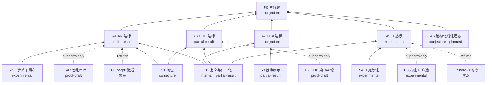

# 命题依赖图

## 当前状态
- 目标命题：P0。
- 当前最高等级：proof-draft（AR-BASE-002、NODE-GRAPH-003）。
- 当前最小缺口：GAP-S1-1 闭包未检验。
- 最近一次审查报告：无；第一个审查对象 AR-BASE-001。

## 依赖图

## 节点登记表
| ID | 命题 | 验证维度 | 等级 | 证据（台账 ID / 文件） | 当前 GAP |
|---|---|---|---|---|---|
| D1 | problem.md 定义与归一化 | data | partial-result | SRC-001、DATA-001、AR-NUM-001 | 全部数据值未逐值认证 |
| S1 | 0–500 ms V/Ca 历史决定 y(500 ms) 21 维 | numerics | conjecture | 无 | GAP-S1-1 |
| S2 | 2 ms 一步算子推 250 步误差可控 | prediction | experimental | AR-BASE-002、AR-GRAD-001 | GAP-A1-1 |
| S3 | PCA256 重建误差低于阈值 | prediction | partial-result | 项目 summary pca_oracle | 阈值未定 |
| S4 | H 补足 S1 缺的信息 | prediction | experimental | NODE-GLOBAL-SCREEN-001 | GAP-A5-1 |
| A1 | AR 在 ≤500 ms 协议下达标 | prediction | partial-result | AR-BASE-002、results/ar/audit_20261008/summary.json | GAP-A1-1 |
| A2 | PCA-GRU 不劣于 AR | prediction | conjecture | PCA-DEPLOY-001 | 未训练 |
| A3 | ODE 同协议下激活 F1 ≥ AR | prediction | partial-result | NODE-GRAPH-003、NODE-EVENT-001 | GAP-A3-1 |
| A5 | 有 H 优于无 H | prediction | experimental | NODE-GLOBAL-SCREEN-001 | GAP-A5-1、GAP-E4-1 |
| A6 | 结构化线性潜态在统一协议下取得可用精度/训练与推理成本折中 | numerics/prediction | conjecture，planned | docs/neural_ode/design.md 同日续节；无运行结果 | GAP-A6-1 |
| P0 | 存在达标算子 G | prediction | conjecture | 无 | 依赖 A1–A5 |
| E1 | AR 七组审计 | prediction | proof-draft | AR-BASE-002；results/ar/audit_20261008/summary.json | 单种子，测试集已暴露 |
| E2 | ODE 第 3/4 轮 90 例 | prediction | proof-draft | NODE-GRAPH-003 | 协议与 E1 不同 |
| E3 | 六组 H 80 更新筛选 | prediction | experimental | NODE-GLOBAL-SCREEN-001 | 短预算 |
| E4 | 九组 500×200 正式训练 | prediction | running | results/neural_ode_full500/session_20261009_recovery/ | GAP-E4-1 |
| E5 | 冻结Pure epoch246保持Neural ODE的求解器加速与误差代价 | numerics/prediction | experimental | archive/ode_inference_speed_20261017/test90_paired_comparison_v2/；docs/neural_ode/design.md；90例模型2.46倍、全流程1.69倍 | 单卡每配置一次；Ca个例退化，阈值未定，非毫秒级；不替代P0验收 |
| E6 | 低维NODE表示与完整计算成本可行性 | numerics | experimental | archive/latent_ode_feasibility_20261017/；archive/neural_ode_results_reorg_20261102/NeuralODE/results/ode_pure/latent_feasibility_20261017/；9候选，局部4096维oracle1.727mV/14.182nM、激活F1 .91071，未训练GPU计算52.077ms | 仅40例拟合/3val重构/1例计时；动力学未训练，事件保真未解决，不支持预测或90例提速结论 |
| C1 | nogru 场误差低但激活 F1 .179 | prediction | 候选，未认证 | AR-BASE-002 补充指标 | 待 failure-case-audit |
| C2 | hard-H 激活时间 MAE 25.2 → 35.5 ms | prediction | 候选，未认证 | NODE-GLOBAL-SCREEN-001 | 待 failure-case-audit |

## GAP 登记

### GAP-S1-1
- 位置：S1。
- 所需结论：观测历史相同、隐态不同的两例未来是否分叉。
- 已试路线：无。
- 失效案例测试：用生成器构造，见 library/definitions/closure.md。
- 影响节点：A1、A3、P0。
- 下一步：写构造脚本方案，按 Slurm 预算申请。

### GAP-A1-1
- 位置：A1。
- 所需结论：激活漏检从 46.86% 降到阈值以下。
- 已试路线：七组消融；nogru 反而最差。
- 影响节点：P0。
- 下一步：与 E4 配对。

### GAP-A3-1
- 位置：A3。
- 所需结论：同协议下激活 F1 ≥ .571。
- 已试路线：第 4 轮微调、BCE 激活损失代数诊断（NODE-LOSS-001）。
- 影响节点：P0。
- 下一步：E4 完成后统一协议重比。

### GAP-A5-1
- 位置：A5。
- 所需结论：hard-H 的时序退化是否在 100000 更新后消失。
- 影响节点：P0。
- 下一步：E4。

### GAP-E4-1
- 位置：E4。
- 所需结论：九组各完成 500 轮、60 例验证与测速。
- 下一步：跟踪 Slurm 7186_0/7188 及其余 8 组。

### GAP-A6-1（2026-10-15，探索计划）
- 所需结论：历史条件化的有限维线性潜态能否保留波前交互与再次激活，同时降低训练/推理成本。
- 依赖：许可训练数据上的表示诊断、历史状态推断及解析推进实现；目前均未运行本卡。
- 影响节点：A6、P0。最小实验与停止条件见项目docs/neural_ode/design.md和ideas.md；单种子短筛选不排除整个方法族，不改变现有作业。

## 证据链
v10 生成器 + 实际 NPZ → 结构/值/节点/切分核查 → Scaler 与可选 PCA 拟合清单 → AR/PCA/Direct/ODE 源码与 checkpoint → 固定协议预测 → 指标/图 → 有限结论。任一上游改变都检查受影响下游；run.json 的源码哈希描述当次执行，不能从后来修改的源文件重建过去代码。几何/参数个体化分支需要新的动力学条件和独立校准/验证数据，目前不从 v10 预测分支继承验证。
Neural ODE 分支（2026-09-17）：v10 原始节点与既有参考图 → 固定量程归一化（无 PCA）→ 训练/验证允许 0–1000 ms 标签、预测输入截断到 500 ms → graph_neural_ode.py → 独立源码快照与 budget.json → round_2_graph（激活坍缩）/ graph_memory_initial（初始化配对）/ round_3_graph_memory（微调）→ 完整场与事件验收。原始运行位于项目 results/neural_ode/session_20260916；99 项回归及梯度/遮蔽证据不能代替预测效果。AR 初始化权重 SHA256 9f39d68870b01e34858f03128789c579c3dd625a6d0ce3b960b668b18fbde048；它的严格监督协议与新微调不同。
空间记忆分支（2026-09-30）：服务器 dataset/batch_000..024.npz → 完整批次 20/2/3 切分、0–500 ms 输入、归一化沿用旧 checkpoint → source_best.pt（SHA 70c58549...）→ 六组共同初始化 → 参考细图连通聚合 132 区域 H → Slurm 7051 实现/数值检查与 7052 最终 36 测试 → 7162 六组 80 更新 → 九组 500×200（7184–7188）。原始证据在项目 results/neural_ode_global_memory/session_20260930/。
