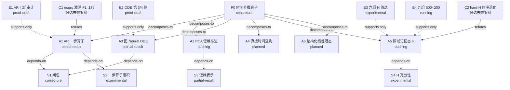

# 研究树

## 当前状态
- 主命题：P0 时间外推算子（problem.md）。
- 当前主路线：A5 区域记忆态 H 的九组正式训练；A1 七组审计作为对照。
- 最新关键事件：2026-10-13 Pure 基线 221/500 轮，4 例 val V 4.85 mV / Ca 26.4 nM、漏检 4.8%。
- 最大障碍：激活 F1 在 A1/A3/A5 上都未达标；S1 闭包未检验。
- 下一步：等九组完成，统一协议配对比较。
- 2026-10-15新增探索计划：训练/推理共同目标下，先评估A4的空间压缩+直接latent时间查询，再比小latent离散推进及A6线性latent；只是候选优先级，不改变既有九组队列。计划见docs/neural_ode/design.md同日续节。

## 路线图

## 分支卡片

### A1 — AR 一步算子
- 状态：partial-result。
- 核心直觉：2 ms 一步算子 + GRU 记忆可以替代 21 维隐态。
- 有序子目标：复现基线 → 七组消融 → 自适应步长。
- 支持证据：AR-BASE-001、AR-BASE-002、E1。
- 当前障碍：晚期 RMSE 66.80 mV、漏检 46.86%；失败类型 failure-case（C1）。
- 下一步：与 E4 配对比较；ar-adaptive-time 实施待选。

### A2 — PCA 低维推进
- 状态：pushing。
- 核心直觉：空间结构可被 256 维基底表示，动力学在系数空间更易学。
- 支持证据：pca_oracle、PCA-DEPLOY-001。
- 当前障碍：S3 下限；GPU 未启动。
- 下一步：GRU 对 MLP 各训练一次。

### A3 — 图 Neural ODE
- 状态：partial-result。
- 核心直觉：连续积分避免离散一步误差累积。
- 支持证据：NODE-GRAPH-003、E2。
- 当前障碍：激活 F1 .567 < .571；协议与 AR 不同（definition-mismatch）。
- 下一步：统一协议后在 E4 中重比。

### A4 — 直接时间查询
- 状态：planned。
- 当前障碍：missing-tool，无严格选模开关。

### A5 — 区域记忆态 H
- 状态：pushing。
- 核心直觉：区域级记忆补足节点 h 缺的全局信息（S4）。
- 支持证据：NODE-GLOBAL-SCREEN-001、E3、E4。
- 当前障碍：hard-H 时序退化（C2 候选）。
- 下一步：九组完成后每组 best 的 60 例验证与测速。

### A6 — 结构化线性潜态（2026-10-15探索提案）
- 状态：planned，conjecture，无运行证据。
- 核心机制：历史编码潜态后，以固定或病例条件化A的exp(τA)/K^m推进；减少非线性积分和长反传。
- 障碍：GAP-A6-1，有限维线性闭包可能不足以表示波前/阻滞/再次激活；先查表示，再查动力学。
- 下一步：与A4直接查询、小latent离散主干在共同表示和固定GPU时间下比较。预算仅草案，不新增或改动远程作业。
