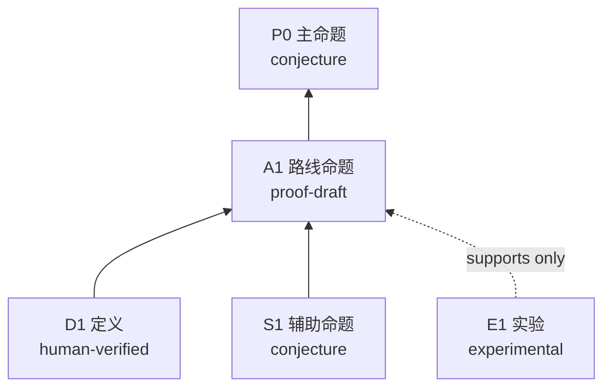

# 命题依赖图

## 当前状态
- 目标命题：
- 当前最高等级：
- 当前最小缺口：
- 最近一次审查报告：

## 依赖图

## 节点登记表
| ID | 命题 | 验证维度 | 等级 | 证据（台账 ID / 文件） | 当前 GAP |
|---|---|---|---|---|---|

## GAP 登记
### GAP-A1-1
- 位置：
- 所需结论：
- 已试路线：
- 失效案例测试：
- 影响节点：
- 下一步：
